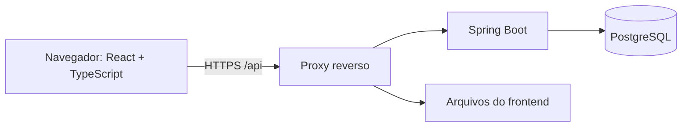
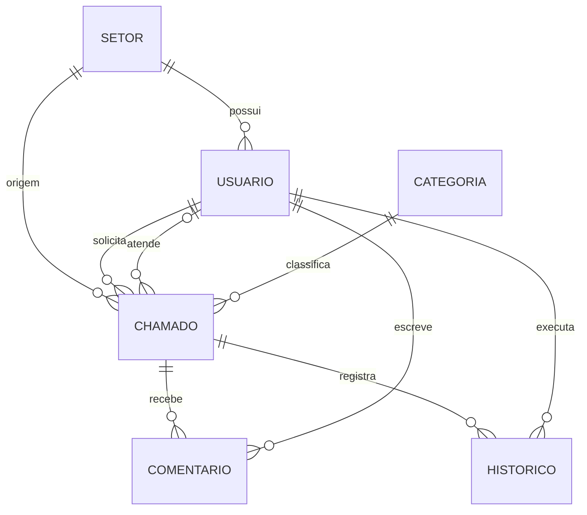

# Arquitetura e modelo de dados

## 1. Visão geral

Adotar um monólito modular: uma aplicação Spring Boot com módulos por domínio e um frontend React com TypeScript. Isso permite transações simples e implantação inicial com poucos componentes.



Em produção, servir frontend e API no mesmo domínio. Em desenvolvimento, configurar o Vite para encaminhar `/api` ao backend, mantendo as chamadas do navegador no mesmo domínio de origem. Se for necessário separar origens, configurar CORS com origens explícitas e credenciais; nunca combinar credenciais com origem curinga.

## 2. Componentes e finalidade

| Componente | Finalidade |
|---|---|
| Java + Spring Boot | Executar e configurar a aplicação |
| Spring Web | Receber requisições HTTP e produzir JSON |
| Spring Security | Autenticação, sessão, CSRF e autorização |
| Spring Data JPA | Persistir entidades e implementar consultas |
| Bean Validation | Validar formato e limites dos dados de entrada |
| PostgreSQL | Armazenar dados e garantir restrições |
| Flyway | Aplicar alterações versionadas no banco |
| React + TypeScript | Construir interface com componentes e contratos tipados |
| Vite | Executar o frontend localmente e gerar os arquivos de distribuição |
| React Router | Mapear URLs para páginas |
| OpenAPI | Documentar os contratos da API |

Na criação do código, escolher uma versão estável suportada do Spring Boot e um Java LTS compatível, conferindo a matriz oficial. Fixar as versões no projeto, versionar o Maven Wrapper e o arquivo de lock do gerenciador do frontend. Este documento não depende de uma versão específica.

## 3. Organização sugerida

```text
backend/src/main/java/br/com/empresa/suporte/
├── SuporteApplication.java
├── config/
├── security/
├── common/exception/
├── usuario/
├── setor/
├── categoria/
└── chamado/
    ├── Chamado.java
    ├── ChamadoController.java
    ├── ChamadoService.java
    ├── ChamadoRepository.java
    ├── dto/
    ├── comentario/
    └── historico/

backend/src/main/resources/
├── application.yml
└── db/migration/

frontend/src/
├── app/
├── components/
├── features/
│   ├── auth/
│   ├── chamados/
│   └── administracao/
├── services/
└── types/
```

Manter classes perto do domínio a que pertencem. Evitar um único serviço com toda a aplicação ou uma hierarquia extensa de classes genéricas.

## 4. Entidades

### Setor

`id`, `nome`, `ativo`, `criadoEm`, `atualizadoEm`.

### Usuário

`id`, `nome`, `email`, `senhaHash`, `perfil`, `setorId`, `ativo`, `trocaSenhaObrigatoria`, `criadoEm`, `atualizadoEm`.

Perfis: `SOLICITANTE`, `TECNICO`, `ADMIN`. Normalizar e-mail com remoção de espaços externos e conversão para minúsculas antes de salvar; aplicar unicidade no banco.

### Categoria

`id`, `nome`, `descricao`, `ativo`, `criadoEm`, `atualizadoEm`.

Exemplos iniciais: rede, acesso, equipamento, impressão e sistemas. Esses são dados de exemplo, não uma taxonomia obrigatória.

### Chamado

`id`, `numeroProtocolo`, `titulo`, `descricao`, `impacto`, `status`, `prioridade`, `solicitanteId`, `setorOrigemId`, `responsavelId`, `categoriaId`, `solucao`, `criadoEm`, `atualizadoEm`, `resolvidoEm`, `fechadoEm`, `canceladoEm`, `versao`.

- `responsavelId` é nulo apenas antes da atribuição ou em cancelamento sem atendimento.
- Na resolução, preencher `solucao` e `resolvidoEm`.
- Ao reabrir, limpar a solução corrente e `resolvidoEm`; preservar a resolução anterior no histórico.
- Datas de fechamento e cancelamento só se aplicam aos respectivos estados terminais.
- `versao` suporta bloqueio otimista com `@Version`.
- Gerar `numeroProtocolo` por sequência; formatar o identificador público como `CH-` seguido do número com no mínimo seis dígitos.

### Comentário

`id`, `chamadoId`, `autorId`, `conteudo`, `visibilidade`, `criadoEm`.

Visibilidades: `PUBLICO` e `INTERNO`. A regra deve existir também na consulta e no mapeamento de DTOs; esconder o componente no frontend não protege a informação.

### Histórico do chamado

`id`, `chamadoId`, `autorId`, `tipoEvento`, `valorAnterior`, `valorNovo`, `justificativa`, `criadoEm`.

Eventos: `ABERTURA`, `STATUS`, `RESPONSAVEL`, `PRIORIDADE`, `CATEGORIA`. Na resolução, registrar também a solução no evento de mudança de status. O histórico é imutável pela API e não deve carregar senhas nem conteúdo de notas internas.

## 5. Relacionamentos



Cada chamado tem um solicitante e, opcionalmente, um responsável. IDs podem ser `BIGINT`; a proteção de acesso não pode depender de IDs difíceis de adivinhar.

## 6. Restrições e índices

- Chaves estrangeiras em todos os relacionamentos; sem exclusão em cascata de usuários para chamados.
- `NOT NULL` nos campos obrigatórios; unicidade de e-mail normalizado e número do protocolo.
- Persistir enums como texto, sem usar posições numéricas.
- Índices iniciais: `(solicitante_id, criado_em)`, `(responsavel_id, status)`, `(status, criado_em)` e chaves estrangeiras usadas em filtros.
- Validar índices com consultas reais; busca por trecho de título pode exigir estratégia própria se o volume crescer.
- Usar `Instant` para instantes no Java e `timestamptz` no PostgreSQL.
- Não utilizar `ddl-auto=update` como mecanismo de evolução. Usar Flyway e `ddl-auto=validate`.

## 7. Migrações planejadas

1. `V1__criar_cadastros.sql`: setores, usuários e categorias.
2. `V2__criar_chamados.sql`: sequência de protocolo, chamados e restrições.
3. `V3__criar_comentarios_historico.sql`: comentários, histórico e índices.

Não editar migrações já aplicadas em ambientes compartilhados: criar uma nova. O primeiro administrador deve ser provisionado por comando ou rotina controlada com segredo externo, exigindo troca de senha. Não versionar credencial padrão.
